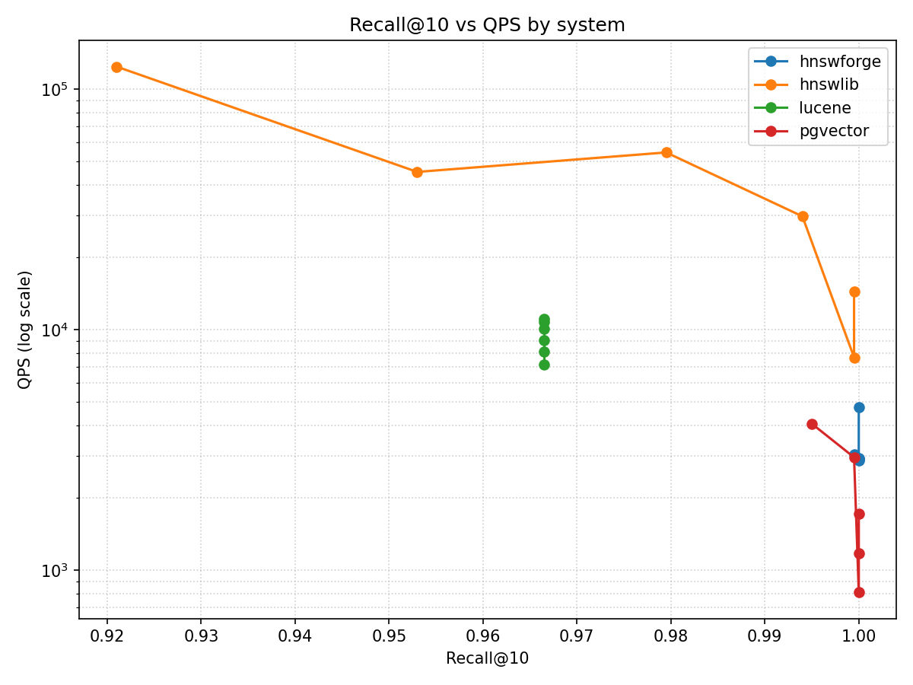
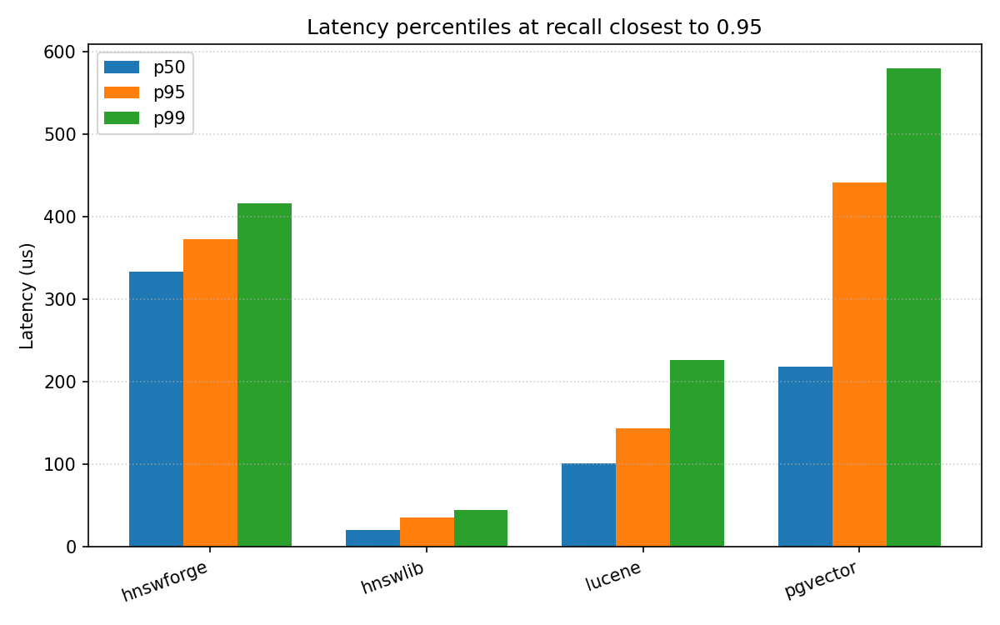
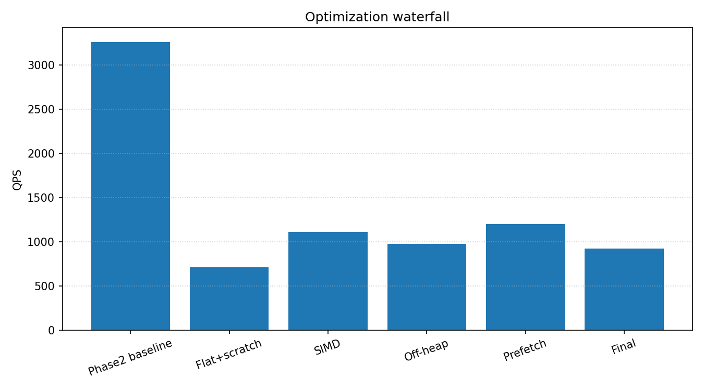
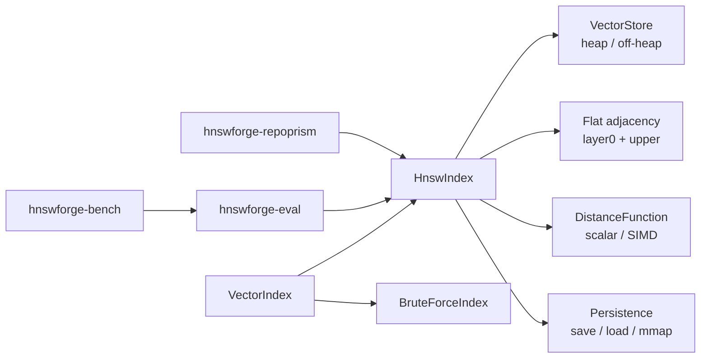

# HNSWForge

[](https://github.com/vishweshpenkar06/HNSWForge/actions/workflows/ci.yml)
[](LICENSE)

A dependency-free Java 25 library implementing HNSW approximate nearest-neighbor search, with SIMD distance kernels, off-heap storage, concurrent inserts and memory-mapped persistence.

## Quick start

```java
import dev.hnswforge.index.*;
import java.util.List;

HnswParams params = HnswParams.builder(128, Metric.L2)
        .m(16).efConstruction(200).efSearch(100).maxElements(100_000).build();
try (HnswIndex index = new HnswIndex(params)) {
    index.add(new float[128]);
    List<SearchResult> results = index.search(new float[128], 10);
    results.forEach(r -> System.out.println(r.id() + " " + r.distance()));
    index.save(java.nio.file.Path.of("index.bin"));
}
```

Build with `./mvnw verify` (JDK 25 required).

## Features

- Exact HNSW insertion/search following Malkov & Yashunin, with both simple and diversity-heuristic neighbor selection
- L2, cosine and inner-product metrics; all exposed as smaller-is-closer distances
- Deterministic level generation from an injected seed
- Flat contiguous vector and adjacency storage, epoch-stamped visited sets, reusable per-thread scratch buffers
- SIMD distance kernels via the Vector API with automatic scalar fallback; off-heap `MemorySegment` storage
- Thread-safe concurrent inserts with striped locks, lock-free searches, and parallel `addAll`
- Versioned, CRC-checked binary format with atomic save, full load and read-only mmap load
- Tombstone deletes and `liveCount()`
- Dataset readers (fvecs/ivecs/bvecs/GloVe), ground truth, recall evaluation, parameter sweep CLI
- JMH microbenchmarks and a baseline comparison harness (hnswlib, Lucene, pgvector)
- Stretch: int8 quantization (4x smaller), filtered search, and a tiny REST server

## Benchmarks

All numbers below are measured on the machine and dataset described in `docs/RESULTS.md`; the chart setup is stated there in full.







On a 100k subset of real SIFT1M, HNSWForge reaches **recall@10 = 0.99998** at ~912 QPS (single thread); hnswlib reaches 4,944 QPS at comparable recall — an honest 5.4x gap analyzed in `docs/RESULTS.md`. On the synthetic 10k/dim-32 corpus recall is 0.9995-1.0000. Core line coverage is 90.3% across 270 tests.

## Architecture



See `docs/ARCHITECTURE.md` for data layouts, search/insert flows and the concurrency memory-ordering argument; `docs/FILE_FORMAT.md` for the binary format.

## Design tradeoffs

- Flat primitive arrays beat object graphs on cache locality and GC pressure, at the cost of fixed capacity and more complex index code.
- SIMD kernels use the incubating Vector API; a scalar fallback keeps the library usable when the module is unavailable.
- Off-heap storage avoids GC scanning but adds FFM read overhead at moderate sizes (measured slower than heap at 100k vectors).
- The diversity heuristic improves recall at the price of denser graphs and more distance computations per query.
- Tombstone deletes are cheap and keep the graph stable but never reclaim memory or repair edges.

## Limitations

- No distributed or sharded mode. Product quantization (S2) was not implemented; int8 scalar quantization is available instead.
- Memory-mapped indexes are read-only: `add` throws `UnsupportedOperationException`.
- Deletes are tombstones; `size()` counts all inserts while `liveCount()` excludes deleted ids.
- Maximum level is capped at 32 and capacity is fixed at construction.
- Real SIFT1M/GloVe and real RepoPrism evaluation data are not bundled; see `docs/TODO_HUMAN.md`.

## Roadmap

Stretch phases in the build spec: int8 scalar quantization, product quantization, filtered search, and a REST server (`hnswforge-server`).

## Reproducing results

```bash
./mvnw verify
scripts/run_benchmarks.sh
python3 scripts/plot_results.py results/sweep_synthetic.csv
```

The comparison requires `pip install hnswlib numpy` (Python <= 3.13 for prebuilt wheels) and `docker compose -f scripts/docker-compose.pgvector.yml up -d` for pgvector. Raw CSVs are in `results/`.

## REST server demo

```bash
./mvnw -q -pl hnswforge-server -am package
java --add-modules jdk.incubator.vector -cp hnswforge-server/target/classes:hnswforge-core/target/classes dev.hnswforge.server.RestServer --port 8080 --dim 4 &
curl -s localhost:8080/health
curl -s -X POST localhost:8080/vectors -d '{"vector":[0.1,0.2,0.3,0.4]}'
curl -s -X POST localhost:8080/search -d '{"vector":[0.1,0.2,0.3,0.4],"k":1}'
```

## Contributing

Issues and PRs are welcome. Run `./mvnw verify` before submitting; record any design deviation in `docs/DECISIONS.md`.

## License

Apache-2.0. See `LICENSE`.
