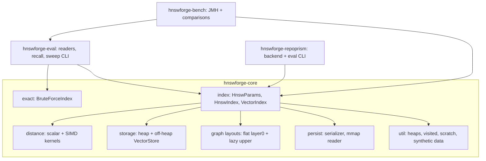

# Architecture

The authoritative design is in `HNSWForge_AGENT_BUILD_SPEC.md` sections 3-10. This document explains the implemented system.

## How HNSW works in one page

HNSW builds a hierarchy of proximity graphs. Every vector is inserted into layer 0; a random subset also appears in higher, sparser layers. The level is drawn from an exponential distribution `floor(-ln(U) * 1/ln(M))`, so roughly `1/M` of nodes reach layer 1, `1/M²` reach layer 2, and so on. Upper layers are express lanes: a search starts at the top entry point and greedily walks to the neighbor closest to the query until no neighbor improves the distance. That lands near the query in layer 0, where a best-first search explores a candidate frontier (a min-heap) while keeping the `ef` best results in a bounded max-heap. Insertion repeats the same descent, then at each layer selects up to `M` neighbors and connects them bidirectionally, pruning any neighbor whose degree exceeds its bound.

The neighbor-selection heuristic matters: choosing only the geometrically closest neighbors traps the graph inside clusters. Algorithm 4 prefers a candidate only when it is not closer to an already-selected neighbor than to the new node, which spreads links across clusters and raises recall substantially. `efConstruction` controls build-time search effort; `efSearch` controls query-time effort; `M` controls memory and degree. Higher values improve recall but cost time and memory.

## Components



## Data layouts

- **Vectors**: `HeapVectorStore` keeps one `float[]` of `capacity * dimension`; vector `id` starts at float offset `id * dimension`. `OffHeapVectorStore` keeps one 64-byte-aligned `MemorySegment` in an `Arena.ofShared()` and reads with the same kernel's segment overload.
- **Layer 0 adjacency**: one `int[]` of `capacity * (1 + maxM0)`. For node `i`, `array[i * (1+maxM0)]` is the degree, followed by up to `maxM0` neighbor ids. Degree words are written with release semantics and read with acquire semantics.
- **Upper layers**: `upper[id]` is allocated lazily only for nodes with level >= 1; it has `level * (1 + M)` ints, with layer `L >= 1` occupying slice `(L-1) * (1+M)`.
- **Visited set**: `VisitedList` holds an `int[]` of stamps and an epoch; `begin()` increments the epoch and clears only on overflow. Each thread owns one via `ThreadLocal<SearchScratch>`, together with its candidate min-heap, bounded result max-heap, query buffer and neighbor-selection scratch arrays.

## Search flow

```mermaid
flowchart TD
    A[validate query and k] --> B[greedy descent from maxLevel to layer 1]
    B --> C[searchLayer at layer 0 with ef = max(efSearch, k)]
    C --> D[{candidate heap empty?}]
    D -- no --> E[pop nearest candidate]
    E --> F{results full and candidate farther than worst?}
    F -- yes --> G[return sorted results]
    F -- no --> H[mark unvisited neighbors, batch them, compute distances]
    H --> I[push promising neighbors into candidate and result heaps]
    I --> D
    D -- yes --> G
```

## Insert flow

```mermaid
flowchart TD
    A[reserve id atomically, store vector] --> B[draw random level, publish node]
    B --> C[greedy descent from maxLevel to level+1]
    C --> D[for each layer from min(level,maxLevel) to 0]
    D --> E[searchLayer with efConstruction]
    E --> F[select up to M neighbors]
    F --> G[write own adjacency under node lock]
    G --> H[connect each neighbor bidirectionally, prune when over degree bound]
    H --> D
    D --> I[update entry point if level exceeds maxLevel]
```

## Deletes (Phase 3)

Deletes are tombstones: `delete(id)` flips an atomic flag and decrements `liveCount()`. Deleted nodes stay in the layered graph and are still traversed during search; they are filtered only when the final result list is built. This keeps the graph structure stable and makes re-upsert cheap (tombstone the old id, insert a new one), but tombstones consume memory and can crowd the `efSearch` result set, so recall degrades as the tombstone fraction grows. There is no graph repair or background compaction.

## Concurrency model (Phase 5)

- `size` and `liveCount` are `AtomicInteger`s; `add` reserves an id with `getAndIncrement()` and publishes the node with a release store to an `AtomicIntegerArray` after its vector, level and upper-layer arrays are initialized. A latch ensures no searcher sees a positive size before the first entry point exists.
- Searches take no locks. They read `entryPoint`/`maxLevel` from volatile fields, acquire-read each degree word via a `VarHandle`, validate neighbor ids against the current size and skip unpublished nodes. Stale-but-valid neighbor reads are tolerated; a node published later becomes visible without a second lookup.
- Neighbor-list writes are guarded by 4096 striped `ReentrantLock`s. At most one node lock is held at a time, so lock ordering is trivially acyclic; the entry-point lock is never acquired while a node lock is held.
- Random level generation is serialized on a small monitor to keep the seeded sequence deterministic; all other insertion work is parallel. `addAll` uses a fixed thread pool and strided id assignment.
- Deletes use an `AtomicIntegerArray` of tombstones and never mutate the graph.

## Persistence

`save` writes a v2 little-endian file (v1 files remain readable) to a temporary sibling and atomically renames it; `load` validates magic, version, endianness, CRC and structural bounds; `loadMapped` memory-maps the file read-only and exposes vectors and layer-0 adjacency directly through a `MemorySegment`. Details are in `docs/FILE_FORMAT.md`.
